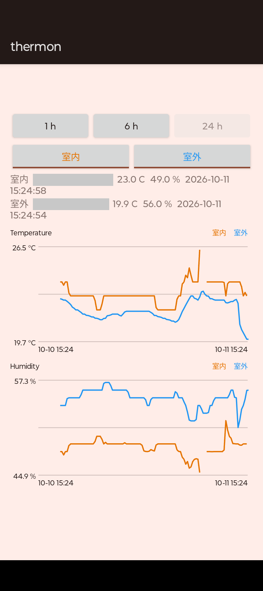

# 開発環境のセットアップ

このドキュメントは Kotlin で Android アプリ (AWS のクライアント) を**Android Studio を使わずに、コマンドラインだけで**開発するための環境構築手順です。ビルド、テスト、整形、静的解析、ドキュメントの生成は Docker の中で実行します (姉妹プロジェクトの [esp32-thermo-system](https://github.com/sluchin/esp32-thermo-system) と同じ方針です)。

> **このドキュメントの状態**: `Dockerfile`、`docker-compose.yml`、Gradle のプロジェクトの雛形 (`core` と `app`) はリポジトリにあります。下の全てのサービスが使えます (Ubuntu 24.04 の Docker イメージ)。「未検証」と書いた項目は CI と無線のデバッグです。

## 方針

| 項目 | 方針 |
|:---|:---|
| 開発環境 | Docker (Ubuntu 24.04)。JDK、Gradle、Android SDK はイメージに入れる。ホストには Docker と、実機に転送するための adb だけを入れる |
| エディタ | 何でもよい (Android Studio は使わない)。整形と静的解析はコマンドで実行する |
| 構成 | 2 つのモジュール。`core` (純粋な Kotlin。AWS のクライアントと、データの処理。単体テストで行と分岐のカバレッジ 100%) と、`app` (Android。画面だけの薄い層) |
| 品質 | 警告ゼロ (Kotlin の警告をエラーにする)。ktlint (整形)、detekt (静的解析)、Android Lint (警告をエラーにする)、JaCoCo (カバレッジ)、Dokka (ドキュメント) |
| テスト | JVM 上の単体テストだけ (JUnit)。エミュレータや、実機での自動テスト (instrumented test) は使わない (エミュレータは手で確認するために使う) |
| 実機での確認 | 別に必要 (画面の表示、AWS への実際の接続は単体テストでは確認できない) |

## 使うツールと版

次の版を使います。版は `gradle/libs.versions.toml` にまとめて書いてあります。

| ツール | 版 | 備考 |
|:---|:---|:---|
| JDK | 17 (Ubuntu の `openjdk-17-jdk-headless`) | Android Gradle Plugin は 17 以上が必要。ホストの JDK は使わない |
| Gradle | 9.8.1 | ラッパー (`./gradlew`) で固定する |
| Android Gradle Plugin | 9.4.1 | Kotlin を内蔵している。`app` に Kotlin のプラグインを別に入れない |
| Kotlin | 2.4.21 | `core` は `org.jetbrains.kotlin.jvm` |
| Android SDK | コマンドラインツール 23.0 (16111833)、`platforms;android-37.0`、`build-tools;37.0.0`、`platform-tools` | `compileSdk` は 37 (下の「注意」を参照) |
| 最小の Android | `minSdk` 26 (Android 8.0) | 仮の値。変えてよい |
| ktlint | Gradle プラグイン `org.jlleitschuh.gradle.ktlint` 14.2.0 | 整形の確認と、自動の整形 |
| detekt | `io.gitlab.arturbosch.detekt` 1.23.8 | 静的解析。1.23.8 が最新の安定版 (2.0 はアルファ版だけ) |
| Android Lint | AGP に内蔵 | `lintDebug`。警告もエラーにする |
| JaCoCo | 0.8.15 | カバレッジ |
| Dokka | `org.jetbrains.dokka` 2.2.0 | ドキュメント (HTML) |
| JUnit | 6.1.3 (`junit-jupiter`)、`kotlin-test-junit5` | 単体テスト |
| AWS SDK for Kotlin | 1.9.17 (`aws.sdk.kotlin:cognitoidentity`、`aws.sdk.kotlin:dynamodb`) | `core` が使う |
| kotlinx.coroutines | 1.11.0 (`core` と、テストの `kotlinx-coroutines-test`) | 中断関数 (`suspend`) のテスト |
| MockK | 1.14.11 | テストで AWS SDK のクライアント (Kotlin のインターフェース) を偽物にする |

## Docker のセットアップ

### 1. Docker のインストール

Docker Engine (または Docker Desktop) と、Docker Compose V2 を入れます (Linux、macOS、Windows。公式の手順: <https://docs.docker.com/get-docker/>)。`docker compose` コマンドを使います。`docker compose version` で確認します。

### 2. ホストのユーザー ID を環境変数にエクスポートする

コンテナはホストのユーザーで実行します (`docker-compose.yml` の `user: "${UID:-0}:${GID:-0}"`)。これにより、`build/` などの生成物が root 所有になりません。手順はシェルの設定ファイルに `UID` と `GID` を書いて、エクスポートします (bash なら、`export UID` と `export GID=$(id -g)` を `~/.bashrc` に書く。zsh は `~/.zshrc`。新しいシェルを開いて、`docker compose run --rm dev id` で確認する)。

### 3. イメージのビルド

初回は JDK、Gradle、Android SDK を含むイメージ `thermon-dev:latest` を作ります (約 2 分、約 2.2 GB。ネットワークが必要です)。`Dockerfile` を変えたときも実行します。

```bash
docker compose build
```

イメージの中身は次のとおりです。

- `ubuntu:24.04` に `openjdk-17-jdk-headless`、`unzip`、`curl`、`git` を入れる。`LANG` と `LC_ALL` は `C.UTF-8` にする (ログの日本語が文字化けしないように)。
- Gradle 9.8.1 を `/opt` に展開する (ラッパー `gradlew` を最初に作るためだけに使う。ビルドは `./gradlew`)。
- Android のコマンドラインツールを `/opt/android-sdk/cmdline-tools/latest` に展開して、ライセンスに同意して (`yes | sdkmanager --licenses`)、`platform-tools`、`platforms;android-37.0`、`build-tools;37.0.0` を入れる。
- `ANDROID_HOME=/opt/android-sdk`、`GRADLE_USER_HOME=/gradle-home` を設定して、`/gradle-home` を誰でも書ける権限 (777) にする。`docker-compose.yml` で名前付きボリュームをここに mount する (Gradle の依存関係のキャッシュ。2 回目からはダウンロードしない)。
- `git config --system --add safe.directory '*'` (コンテナの中の git がホストの所有のディレクトリを扱えるようにする)。

SDK は**読み取り専用**として使います (コンテナは一般ユーザーで動くため)。足りないコンポーネントがあると、Gradle がインストールを試みて、失敗します。新しい SDK のコンポーネントが必要になったら、`Dockerfile` の `sdkmanager` の行に足して、イメージを作り直します。

### 4. Gradle ラッパー

Gradle のラッパー (`gradlew`、`gradlew.bat`、`gradle/wrapper/`) はリポジトリにコミットしてあります。ビルドは `./gradlew` で行います (Gradle の版は `gradle/wrapper/gradle-wrapper.properties` で固定)。

Gradle の版を上げるときだけ、イメージの中の Gradle でラッパーを作り直します (`Dockerfile` の `GRADLE_VERSION` も、そろえます)。

```bash
docker compose run --rm dev gradle wrapper --gradle-version <GRADLE_VERSION>
```

このリポジトリの `.gitignore` は `*.jar` を無視するので、ラッパーの `gradle/wrapper/gradle-wrapper.jar` だけ、例外 (`!gradle/wrapper/gradle-wrapper.jar`) にしてあります。`.gradle/`、`build/`、`local.properties`、`.kotlin/` も無視します。

### 5. 構成

```
Dockerfile, docker-compose.yml   開発環境 (Docker). Dockerfile は, 2 段 (dev と emulator)
scripts/                         エミュレータの起動 (emulator.sh) と, 待ち合わせ (emulator-wait.sh).
                                 クラウドのセッションで Docker を使う補助 (cloud-docker.sh) と,
                                 Maven Central のミラーの初期化スクリプト (maven-mirror.init.gradle.kts)
.github/                         GitHub Actions (workflows/build.yml と, Docker イメージと Gradle キャッシュのアクション)
.claude/                         Claude Code の設定 (CLAUDE.md と, クラウドのセッションで Docker のデーモンを起動するフック)
CODING_STYLE.md                  コーディングスタイル (今は, Kotlin の公式の規約へのリンクだけ)
settings.gradle.kts              モジュール: :core と :app
build.gradle.kts                 プラグインの宣言だけ (各モジュールで適用する)
gradle/libs.versions.toml        ライブラリとプラグインの版 (版カタログ)
gradle.properties                Gradle の設定
config/detekt/detekt.yml         detekt の規則 (既定に, 上書きするもの)
.editorconfig                    ktlint (整形) の設定を含む
core/                            純粋な Kotlin (AWS のクライアントと, データの処理). カバレッジ 100%
  CognitoUnauthenticatedCredentials  Cognito の未認証の ID から, 一時的な認証情報を受け取る
  DynamoDbReadings (ReadingsRepository) DynamoDB の Query で, 機器の測定値を取り出す
  Reading, formatReading         測定値と, 表示用の文字列 (formatChartTime, formatChartValue も)
  Chart                          グラフ用のデータ (範囲, 平均, 線の切れ目, 縦軸の範囲)
  NodeSnapshot                   1 台の機器の, 最新の値と, 温度と湿度と気圧のグラフ (loadSnapshot)
app/                             Android (画面だけの薄い層. 設定の読み込みと, 描画)
  OutdoorAlert                   室外の通知の判定 (findOutdoor, detectAlerts, newAlerts)
  ReadingStore                   端末に保存した測定値の入り口と, 保存する測定値の選び方 (selectToStore), AWS との同期 (syncReadings)
  MainActivity                   画面 (RangeBar と, ChartsPanel)
  RangeBar, SqliteReadingStore   範囲 (近道のボタンと開始・終了の日付) を選ぶ部品, 端末の SQLite の保存先
  OutdoorAlertWorker             室外の通知 (WorkManager。15 分ごと。温度 0 ℃ 未満, 湿度 80 % 超)
  ChartsPanel, LineChartView     機器のボタンと 2 つのグラフ, 折れ線グラフ (Canvas. ライブラリなし. 複数の線を重ねる)
```

## コマンド

### Docker のサービス

`docker-compose.yml` に次のサービスがあります。名前は esp32-thermo-system に合わせました。どれも `--rm` を付けて実行します。

| サービス | 内容 | 実行する Gradle のタスク |
|:---|:---|:---|
| `dev` | 開発シェル (`bash`) | なし |
| `build` | デバッグ用の APK をビルドする。警告が出たら失敗する | `:app:assembleDebug` |
| `test` | 単体テストを実行する | `:core:test` `:app:testDebugUnitTest` |
| `coverage` | `core` の行と分岐のカバレッジが 100% でなければ失敗する | `:core:test` `:core:jacocoTestCoverageVerification` |
| `format` | 整形が必要なら失敗する (確認だけ) | `:core:ktlintCheck` `:app:ktlintCheck` |
| `format-fix` | 整形して、ファイルを書き換える。自動で直せない指摘があると、終了コード 1 になる (直したあとに `format` で確認する) | `:core:ktlintFormat` `:app:ktlintFormat` |
| `analyze` | 静的解析。指摘があれば失敗する | `:core:detekt` `:app:detekt` `:app:lintDebug` |
| `docs` | ドキュメント (HTML) を生成する (`core/build/dokka/html/index.html`)。ドキュメントのない公開のものがあれば (警告になる) 失敗する | `:core:dokkaGenerate` |
| `emulator` | Android エミュレータを KVM で動かす (`docker compose up -d emulator`。画面はブラウザ <http://localhost:6080/vnc.html>)。「エミュレータ (Docker)」を参照 | なし |
| `clean` | 生成物 (`build/`、`core/build/`、`app/build/`、`.gradle/`、`.kotlin/`) を消す。Gradle のキャッシュ (Docker のボリューム) は消さない | なし |

```bash
# 例
docker compose run --rm build
docker compose run --rm test
docker compose run --rm format-fix
docker compose run --rm analyze
docker compose run --rm clean
```

Gradle のキャッシュ (依存関係のダウンロード) も消すときは `docker compose down -v` でボリューム `gradle-cache` を消します (次の実行で、ダウンロードし直します)。

コードを修正したら、`format-fix`、`format`、`analyze`、`test`、`coverage`、`build` の順に全て通ることを確認します (CI も、同じサービスを実行します。「CI (GitHub Actions)」)。

### Gradle のタスクを直接実行する

`dev` のシェルの中で、`./gradlew` を実行できます。`--no-daemon` を付けると、コンテナを終了したときに、Gradle のプロセスが残りません。検証では、次のコマンドで**全てが成功**しました (2 回目以降は約 30 秒から 1 分半。初回は依存関係のダウンロードで数分かかります)。

```bash
./gradlew --no-daemon --continue \
    :core:ktlintCheck :core:detekt :core:test :core:jacocoTestCoverageVerification \
    :core:dokkaGenerate :app:assembleDebug :app:testDebugUnitTest :app:lintDebug \
    :app:ktlintCheck :app:detekt
```

- `--continue`: 途中のタスクが失敗しても、残りのタスクを実行して、全ての指摘を一度に見られます。
- 生成物: APK は `app/build/outputs/apk/debug/thermon-<版>-debug.apk` (検証したサンプルは AWS SDK を含めて、約 4.2 MB)。テストのレポートは `core/build/reports/tests/test/index.html` と `app/build/reports/tests/testDebugUnitTest/index.html`。カバレッジは `core/build/reports/jacoco/test/`。detekt、ktlint、Android Lint のレポートは各モジュールの `build/reports/`。ドキュメントは `core/build/dokka/html/index.html`。

### 整形と静的解析の動き (検証済み)

- **ktlint**: 整形が崩れていると、`ktlintCheck` が失敗して (終了コード 1)、ファイルの場所と、理由を表示します。`ktlintFormat` で自動で直ります。直したあとの `ktlintCheck` は成功します。
- **detekt**: 設定は `buildUponDefaultConfig = true` (既定の規則)。マジックナンバーなども、検出します (検証では、サンプルのコードの数字を検出した)。設定は `config/detekt/detekt.yml` に足します (今は `maxIssues: 0` だけ)。
- **Android Lint**: `lint { warningsAsErrors = true; abortOnError = true }` で警告もエラーにします。検証では、`targetSdk` が最新でないこと、アプリのアイコンがないこと、バックアップの設定 (`dataExtractionRules` と `fullBackupContent`) がないことを検出しました。
- **Kotlin のコンパイラ**: `allWarningsAsErrors` を `true` にして、警告をエラーにします。検証では、非推奨の関数を呼ぶと、`warnings found and -Werror specified` でビルドが失敗しました。なお、未使用の変数は Kotlin のコンパイラの警告にはなりません (IDE の検査で、コンパイラは出しません)。
- **Dokka**: `reportUndocumented` を有効にして、`failOnWarning` を `true` にしています。KDoc のない公開の関数があると、`Undocumented` の警告で、`docs` が失敗します。
- **JaCoCo**: `jacocoTestCoverageVerification` に行 (`LINE`) と分岐 (`BRANCH`) の最小値を 1.0 (100%) とする規則を置きます。UI の層 (`app`) は対象外です (薄い層にする)。

## AWS への接続

アプリ (`core`) は AWS IoT Core が DynamoDB に保存したデータを**Cognito の ID プールの未認証ロール**で読み取ります (ログインはありません)。

```
Kotlin アプリ ──> Cognito ID プール (未認証) ──一時的な認証情報──> DynamoDB (テーブル thermo-readings)
                                                                       Query (読み取りだけ)
```

AWS 側の準備 (テーブル `thermo-readings`、IoT のルール、ID プール、未認証ロール) は [AWS_DYNAMODB.md](AWS_DYNAMODB.md) の手順で行います。テーブルはパーティションキーが `node` (機器の MAC アドレス)、ソートキーが `ts` (UNIX 時刻 [s]) です。未認証ロールの権限は**そのテーブルの `dynamodb:Query` だけ**にします。

### クライアント (`core`)

| クラス | 役割 |
|:---|:---|
| `CognitoUnauthenticatedCredentials` | ID プールから、未認証の ID (`GetId`) と、一時的な認証情報 (`GetCredentialsForIdentity`) を受け取る。ID は最初の 1 回だけ取り、認証情報は期限の 5 分前まで、使い回す。同時に呼ばれても、取得は 1 回 |
| `DynamoDbReadings` (`ReadingsRepository`) | `range(node, 開始, 終了)`: 機器の、時刻の範囲の値を古い順に取り出す (結果が 1 MB を超えるときは `lastEvaluatedKey` で続きを取り出す)。`latest(node)`: 最新の 1 件を取り出す |
| `Reading` | 1 件の測定値 (`node`、`ts`、`type`、`temperatureC`、`humidity`、`battery`、`pressureHpa`)。`temperature_c` などがない、または数値として読めない項目は除く |
| `formatReading` | 測定値を 1 行の文字列にする (時刻は指定したタイムゾーン) |
| `ChartRange` / `customWindow` | グラフの範囲 (1 時間、6 時間、24 時間、7 日、30 日、1 年)。日付で選んだ範囲 (`customWindow`。開始の日の 0 時から、終了の日の終わりまで) も、窓にする。現在から、過去に向かう窓と、平均する区切りの長さ (どの範囲も、線の点は 120 個) を決める |
| `buildChartSeries` | 測定値を区切りごとに平均して、グラフの 1 本の線にする。測定値のない区切りが、2 つを超えて続いたら、線を切る (機器が止まっていた間をつながない)。縦軸の範囲は値の最小と最大に 5% の余白を足したもので、幅が最小の幅 (温度は 1 ℃、湿度は 5%、気圧は 4 hPa) より小さいときは広げる |
| `selectToStore` / `syncReadings` / `ReadingStore` | AWS の新しい測定値を取り出して、変化があったもの (と、1 時間に 1 点) を端末に保存する。DynamoDB は 30 日しか残さないので、保存した最後の時刻の次の秒から (なければ 30 日前から) 取り出す |
| `loadSnapshot` / `NodeSnapshot` | 1 台の機器の、AWS の新しい測定値を端末に保存して、保存した測定値から、最新の測定値と、温度と湿度と気圧のグラフを作る。AWS に届かないときは、保存した測定値で表示する (`syncError`)。保存した測定値もなければ、失敗をそのまま伝える (画面に表示する) |

### 設定

接続先はリポジトリに入れません。`local.properties` (コミットしない) に書くか、Gradle のプロパティ (`-Pthermon.table=...`) で渡します。ビルドのときに、`BuildConfig` に入ります。

```properties
# local.properties (リポジトリの直下。.gitignore で無視する)
thermon.region=ap-northeast-1
thermon.identityPoolId=ap-northeast-1:xxxxxxxx-xxxx-xxxx-xxxx-xxxxxxxxxxxx
thermon.table=thermo-readings
# 機器の MAC アドレス (コンマ区切り). =のあとに表示名を付けられる (UTF-8)
thermon.nodes=AA:BB:CC:DD:EE:01=室外,AA:BB:CC:DD:EE:02=室内
```

- `thermon.nodes` の表示名 (`=室外` など) は省けます。付けると、画面に「室外 (AA:BB:CC:DD:EE:01)」の形で出ます。`local.properties` は UTF-8 で読むので、日本語を書けます。
- `thermon.region` の既定は `ap-northeast-1`、`thermon.table` の既定は `thermo-readings` です。`thermon.identityPoolId` と `thermon.nodes` は既定が空で、空のままだとアプリは「AWS is not configured」と表示します。
- 設定を変えたら、`docker compose run --rm build` でビルドし直します。

### 安全のために

- ID プールの ID はアプリのファイルから取り出せます。そのため、**ID を知っていれば、誰でも未認証ロールの権限を使えます。** 権限は読み取り (`dynamodb:Query`) だけに絞り、対象も、このテーブルだけにします。
- アクセスキーはアプリにもリポジトリにも入れません (必ずCognito の一時的な認証情報を使います)。
- ほかの人に配るときは Cognito のユーザープールによるログインに替えます。

### 確認の範囲

- **単体テスト**: Cognito と DynamoDB のクライアントを MockK で偽物にして、認証情報の取得とキャッシュ、期限での取り直し、同時の呼び出し、応答に項目がないときの例外、`Query` の要求 (キー条件、`lastEvaluatedKey`、新しい順の 1 件)、読めない項目の除外を確認しています (`core` の行と分岐のカバレッジ 100%)。
- **ビルド**: 設定が `BuildConfig` に入ります。設定がないときは空になります。
- **実機での動作**: AWS の準備 ([AWS_DYNAMODB.md](AWS_DYNAMODB.md)) をして、`local.properties` に書き、実機の Android 端末に入れて、起動します。実際の AWS (Cognito の ID プール、DynamoDB のテーブル、未認証ロール) に接続して、機器ごとの最新の測定値(温度、湿度、受信した時刻)が**文字列で**表示されます。手順は次の「アプリを動かして確認する」です。
- **グラフの表示**: 温度と湿度と気圧の 3 つのグラフに機器ごとの線を重ねて表示します (気圧は、気圧センサのある機器だけ)。グラフの上の機器のボタン (`室内`、`室外` など。表示名は `thermon.nodes` で付けます) を押すと、その機器の線を出したり消したりします (最初は全て表示)。線の色は設定の順に橙、青、緑、紫で、グラフの右上の凡例と、ボタンの文字の色が同じです。縦軸は表示している線が全て入る範囲にそろいます。機器ごとの最新の測定値の 1 行はボタンの下に出ます。範囲のボタン (1 h、6 h、24 h、7 d、30 d、1 y) と、開始と終了の日付のボタン (カレンダー) で横軸と線が変わります。縦軸の値と、横軸の開始と終了の時刻 (端末のタイムゾーン) も表示します。測定値のない範囲は「No data in this range」と表示します。

  <a href="assets/thermon-chart.png"></a>

  MAC アドレスは画像の中で隠してあります。

## エミュレータ (Docker)

Android のエミュレータを Docker の中で動かして、PC の上でアプリを確認できます。KVM (ハードウェア仮想化) を使うので、速く動きます。画面はコンテナの中の仮想の画面 (Xvfb) に出して、**ブラウザ (noVNC)** で見ます (ホストの画面の設定は要りません。Wayland でも使えます)。

### 準備

1. ホストの `/dev/kvm` を使えること (`ls -l /dev/kvm`)。コンテナの中では、`kvm` グループの権限が必要です。ホストの `kvm` グループの ID をシェルの設定ファイルでエクスポートします (`UID` と `GID` と同じ方法)。

   ```bash
   export KVM_GID=$(getent group kvm | cut -d: -f3)
   ```

2. エミュレータ用のイメージを作ります (**約 9 分、約 10.7 GB**。Android Emulator と、システムイメージ (API 36、Google API、x86_64) を含みます。通常の `dev` のイメージには入れません)。

   ```bash
   docker compose build emulator
   ```

### 使い方

```bash
# 起動 (初回は, AVD (仮想の端末) を作る. バックグラウンドで動かす)
docker compose up -d emulator

# 起動し終わって, 落ち着くまで待つ (アニメーションも止める)
docker compose exec emulator scripts/emulator-wait.sh

# APK を入れて, アプリを起動する (先に docker compose run --rm build で, APK を作っておく)
docker compose exec emulator adb install -r app/build/outputs/apk/debug/thermon-*-debug.apk
docker compose exec emulator adb shell am start -n jp.thermon.app/.MainActivity

# 画面を, 画像にする (build/emulator-screen.png)
docker compose exec emulator bash -c 'adb exec-out screencap -p > build/emulator-screen.png'

# ログを見る
docker compose exec emulator adb logcat -d | tail

# 止める (AVD は, ボリューム emulator-avd に残る)
docker compose down
```

- **ブラウザで見る**: <http://localhost:6080/vnc.html> を開いて、「接続」を押します (パスワードはありません。接続できるのはこのPC (`127.0.0.1`) だけです)。マウスでタッチの操作もできます。
- 画面なしで使うときは環境変数 `EMULATOR_HEADLESS=1` で起動します (`adb` だけで操作する)。
- AVD も Gradle のキャッシュも消すときは `docker compose down -v` です (次の起動で、AVD を作り直します)。

### 動作の範囲

次の動作ができます。

- KVM でエミュレータが起動して、`sys.boot_completed` が 1 になる。
- APK のインストールと、アプリの起動。画面は `adb exec-out screencap` で画像にできます (「AWS is not configured. ...」の表示)。
- 同じ署名の APK を上書きでインストールできる (下の「デバッグ用の署名の鍵」)。
- noVNC のページが `http://localhost:6080/vnc.html` で応答する (HTTP 200)。

**未検証**: ブラウザでの表示と、マウスの操作。

### 注意 (動かして分かったこと)

- **KVM の権限**: コンテナの中の `/dev/kvm` はホストの `kvm` グループ専用です (ホストの個人の許可 (ACL) は引き継がれません)。`KVM_GID` をエクスポートしないと、エミュレータは `no access to /dev/kvm` で終了します。`group_add` を変えたら、コンテナを作り直します (`docker compose up -d emulator`)。
- **起動の直後は重い**: ソフトウェア描画 (SwiftShader) のため、CPU を 1 から 2 コア分使います。起動の直後に「System UI isn't responding」(ANR) が出ることがあります。`scripts/emulator-wait.sh` で落ち着くまで待ちます。出たときはブラウザで「Wait」を押すか、`adb shell input tap 322 1364` (Pixel 6 の AVD の座標) を実行します。
- **edge-to-edge**: Android 15 以降 (`targetSdk` 35 以上) では、画面がシステムバーの下まで広がります。エミュレータで確認して初めて、文字がアクションバーの下に隠れる不具合に気付きました (`MainActivity` で余白をパディングに入れて、直した)。画面を作るときは必ずシステムバーの余白を考えます。
- **デバッグ用の署名の鍵**: コンテナを起動するたびに、`debug.keystore` が作り直されると、署名が変わって、`INSTALL_FAILED_UPDATE_INCOMPATIBLE` で上書きできません。鍵はボリューム `gradle-cache` (`/gradle-home/android`) に残してあります。古い署名のアプリが残っているときだけ、`adb uninstall jp.thermon.app` で消します。
- 初回の AVD の作成と、起動は数分かかります。`-no-snapshot` で毎回、最初から起動します (スナップショットは使いません)。

## 実機へのインストール (ホストの adb)

adb はホストで実行します (Docker に USB を渡す設定を避けるため)。次の手順は無線の接続を除きます。

1. ホストに adb を入れます。Ubuntu / Debian では、`sudo apt install adb`。
2. 端末で、開発者向けオプションを出して、USB デバッグを有効にします。メニューの名前は機種と Android のバージョンで違います。
   1. 「設定」→「デバイス情報」(機種によっては、「スマートフォン情報」「端末情報」)を開き、「ビルド番号」を 7 回タップします (画面ロックの PIN などを求められることがあります)。
   2. 「設定」→「システム」→「開発者向けオプション」を開き、「USB デバッグ」をオンにします (機種によっては、「開発者向けオプション」の場所が違います)。
   3. USB で接続します。端末に「USB デバッグを許可しますか?」と出たら、許可します (「このパソコンを常に許可する」にチェックすると、次回から出ません)。USB のモードが「充電のみ」で認識されないときは「ファイル転送」にします。
   4. 機種によっては (Xiaomi など)、「USB デバッグ (セキュリティ設定)」も有効にしないと、`adb install` が拒否されます。
3. 接続を確認します。`adb devices` で端末が `device` と表示されれば成功です (`unauthorized` なら、端末の許可の画面を確認します。何も表示されないときは udev の規則を確認します)。
4. APK をインストールします。

   ```bash
   adb install -r app/build/outputs/apk/debug/thermon-*-debug.apk
   ```

5. ログを見るときは `adb logcat` を使います (`adb logcat -s <タグ>` で絞れます)。

インストールしたあとの、アプリの起動と確認は次の「アプリを動かして確認する」です。

無線で接続するときは端末の「ワイヤレス デバッグ」を有効にして、`adb pair <アドレス>:<ポート>` でペアリングして、`adb connect <アドレス>:<ポート>` で接続します (未検証)。

エミュレータは Docker の中で動かせます (次の節の「エミュレータ (Docker)」)。

## アプリを動かして確認する

AWS の準備 ([AWS_DYNAMODB.md](AWS_DYNAMODB.md)) が終わったあとの手順です。

1. **AWS にデータが入っているか確認する** (アプリより先に)

   ```bash
   aws dynamodb scan --region ap-northeast-1 --table-name thermo-readings --max-items 5
   ```

   項目が返れば、ゲートウェイ、IoT Core、ルール、DynamoDB が動いています。空なら、[AWS_DYNAMODB.md](AWS_DYNAMODB.md) の 5 章の「何も入らないとき」を見ます。

2. **`local.properties` に接続先を書く** (リポジトリの直下。コミットしない)

   ```properties
   thermon.region=ap-northeast-1
   thermon.identityPoolId=<6.1 の IdentityPoolId>
   thermon.table=thermo-readings
   thermon.nodes=<機器の MAC アドレス (コンマ区切り)>
   ```

   `thermon.nodes` は DynamoDB の `node` と、**同じ MAC アドレス** (大文字・小文字も、コロンも同じ) にします。`<MAC アドレス>=室外` のように、表示名を付けられます (例: `thermon.nodes=ED:2E:C4:46:3B:11=室外,00:AA:01:00:00:42=室内`)。

3. **ビルドする** (値を変えたら、ビルドし直す)

   ```bash
   docker compose run --rm build
   ```

   APK は `app/build/outputs/apk/debug/thermon-<版>-debug.apk` にできます。

4. **端末に入れる** (前の節の手順で、USB デバッグを有効にして、接続しておく)

   ```bash
   adb install -r app/build/outputs/apk/debug/thermon-*-debug.apk
   ```

5. **アプリを開く**
   - 端末のアプリ一覧から、**`thermon`** をタップします (温度計のアイコン。見つからないときは一覧の検索欄に「thermon」と入力します)。
   - PC から起動するときは `adb shell am start -n jp.thermon.app/.MainActivity` です。
   - インストールの確認は `adb shell pm list packages | grep thermon` (`package:jp.thermon.app` と出れば成功)。

6. **表示を確認する**
   - 正常なら、画面の上に範囲を選ぶボタン (1 h、6 h、24 h、7 d、30 d、1 y。選んでいるボタンは薄く表示される。既定は 6 h) と、開始と終了の日付のボタン (最初は未設定の `-`) と、日付を消す `Clear` のボタンが出ます。その下に機器を選ぶボタンと、機器ごとの最新の温度、湿度、気圧、受信した時刻の 1 行と、温度と湿度と気圧のグラフが出ます。ボタンを押すと、その範囲で取り出し直します (取り出している間は「Loading…」)。
   - 「AWS is not configured」と出るなら、`thermon.identityPoolId` か `thermon.nodes` が空です。直して、ビルドし直します。

うまくいかないとき:

| 症状 | 確認すること |
|:---|:---|
| 認証のエラー (`NotAuthorizedException` など) | ID プールで未認証 ID が有効か (6.1 の `--allow-unauthenticated-identities`) |
| 権限のエラー (`AccessDeniedException`) | 未認証ロールが ID プールに登録されているか (`aws cognito-identity get-identity-pool-roles`)。ポリシーの `Resource` (アカウント ID、テーブル名) |
| 表示が空 | `thermon.nodes` と、DynamoDB の `node` が一致しているか。手順 1 でデータが入っているか |
| そのほか | `adb logcat -d \| tail -50` でエラーを見る |

## CI (GitHub Actions)

Push 時に `.github/workflows/build.yml` が開発用の Docker イメージ (Dockerfile の `dev` ステージ) で `docker compose` のサービスを実行します。ローカルと同じ環境です。

| ジョブ | 実行するサービス | 内容 |
|:---|:---|:---|
| `check` | `build` / `test` / `coverage` / `format` / `analyze` | 1 サービスずつ、別のジョブで実行する。失敗したら、ジョブが失敗する。ログをアーティファクト `<サービス名>_log` に保存する |
| `docs` | `docs` | Dokka の HTML を生成する。警告があれば失敗する。生成物をアーティファクト `docs` にログを `docs_log` に保存する |
| `deploy-docs` | (`docs` の成果物) | main への push のときだけ、ドキュメントを GitHub Pages へ公開する |
| `cleanup` | (なし) | 3 日より前の実行 (ログと artifact) を push のたびに削除する |

- 実行するのは `main` と `ccr-*` ブランチへの push と、main への PR です。
- **APK はアーティファクトに置きません** (ログだけを保存します)。
- アーティファクトは `retention-days: 3` で 3 日で期限が切れます。保存する期間を変えるときは `build.yml` の `KEEP_DAYS` と、全ての `retention-days` をそろえて変えます。
- Docker イメージはレイヤーを GitHub Actions のキャッシュに保存します (`.github/actions/docker-image`)。Gradle の依存関係と、Gradle 本体も、キャッシュに保存します (`.github/actions/gradle-cache`)。`docker-compose.yml` の `GRADLE_HOME_DIR` にキャッシュするディレクトリを指定すると、ボリューム `gradle-cache` の代わりに、そのディレクトリを使います (ローカルでは、指定しない)。
- **GitHub Pages の設定** (最初の 1 回): リポジトリの Settings > Pages > Source を「GitHub Actions」にします。公開されるのは `core` の API ドキュメント (Dokka) です。`SETUP.md` などの Markdown の文書は含まれません。
- **未検証**: GitHub Actions 上での実行 (ワークフローは YAML の構文と、`GRADLE_HOME_DIR` でのローカルの実行だけ)。最初の実行で、イメージのビルドと、Gradle の依存関係の取得に時間がかかります。

## クラウドのセッション (claude.ai/code)

スマホやブラウザのクラウドのセッション (Claude Code on the web) でビルドするための設定です。クラウドの VM は通信をプロキシ経由にするので、コンテナ (Docker) の中の通信はそのままでは失敗します (curl の終了コード 60)。`scripts/cloud-docker.sh` がこれを避けます。

> **状態** (2026-10-11): クラウドで `scripts/cloud-docker.sh build` と `scripts/cloud-docker.sh run build` が成功しました (APK 4.7 MB)。`test` (2 分 15 秒)、`coverage` (`core` の行と分岐が 100%)、`analyze`、`format`、`docs` も、クラウドですべて成功しました。ベースのイメージ (`ubuntu:24.04`) の取得が Docker Hub の 429 で失敗したときは `build` が Google のミラー (`mirror.gcr.io`) から取ります。

### 環境の設定 (ブラウザ)

<https://claude.ai/code> のメッセージ欄の上の、雲のアイコン (環境の名前) から、「Cloud」→ 環境の設定のアイコンでダイアログを開きます。

| 欄 | 入れるもの |
|:---|:---|
| Network access | 「Custom」。「Allowed domains」に `dl.google.com` と `maven-central.storage-download.googleapis.com` を 1 行ずつ (標準の許可リストも、残す) |
| Environment variables | `GIT_AUTHOR_NAME` などの 4 行 (コミットの名前)。`GRADLE_HOME_DIR` は要りません (クラウドでは、`scripts/cloud-docker.sh` が `/var/cache/thermon-gradle` を使います) |
| Setup script | 下 |

```bash
#!/bin/bash
git config --system user.name "Tetsuya Higashi" || true
git config --system user.email "996846+sluchin@users.noreply.github.com" || true

exit 0
```

- **Maven Central の `429` を避ける設定はスクリプトに入れません。** `scripts/cloud-docker.sh run` がクラウドのときに、毎回、`scripts/maven-mirror.init.gradle.kts` を Gradle のホーム (`/var/cache/thermon-gradle`。`GRADLE_HOME_DIR` で変えられる) の `init.d/` に置きます。Google のミラーを先に参照します (ミラーにない成果物は次のリポジトリが引き受けます)。貼り付けで壊れることも、新しいセッションを待つこともありません。
- `run` はミラーに届くかを確かめて、届かないときは `WARNING` を出します (「Allowed domains」の設定が足りないとき)。
- 環境の変数とセットアップスクリプトの変更は**新しいセッション**から効きます。

### 使い方

```bash
scripts/cloud-docker.sh build      # 開発用のイメージ (thermon-dev) を作る. 最初の 1 回 (数分)
scripts/cloud-docker.sh run build  # docker compose run --rm build (test, coverage, format, analyze, docs も同じ)
```

- Docker のデーモンは SessionStart フック (`.claude/settings.json`) がセッションの開始のときに起動します (クラウドのときだけ)。起動していないときは `scripts/cloud-docker.sh start` です (ログは `/tmp/dockerd.log`)。
- 通常の `docker compose build` と `docker compose run` はクラウドでは使いません。
- プロキシのポートはセッションの途中でも変わります。スクリプトが実行のたびに `$HTTPS_PROXY` から読みます。
- プロキシは HTTPS (`curl`、Java) だけに渡します。`HTTP_PROXY` は渡しません (`apt` がプロキシに拒否されたため)。それでも `apt` が失敗するときは環境の「Allowed domains」に `archive.ubuntu.com` と `security.ubuntu.com` を足します。
- イメージに入れたプロキシの CA が古くなったとき (TLS のエラーが出たとき) は `build` で作り直します。

### スクリプトの動作

- CA の束を証明書ごとに 1 ファイルに分けて入れると、システムと、Java の信頼ストア (`cacerts`) の両方に入る。
- `build` は `Dockerfile` に 4 行を足したコピーでビルドして、リポジトリの `Dockerfile` は変えない。イメージにプロキシの設定は焼き込まれない。
- `run` は `network_mode: host` と、プロキシの環境変数 (`HTTPS_PROXY`、`JAVA_TOOL_OPTIONS` など) をコンテナに渡す。

## 注意 (検証で分かったこと)

- **`compileSdk` は 37 以上にする。** AWS SDK for Kotlin が使う OkHttp 5.5 が `compileSdk` 37 以上を要求します (36 だと、`checkDebugAarMetadata` が失敗します)。`targetSdk` も、Android Lint の `OldTargetApi` のため、最新 (37) にします。
- **`buildToolsVersion` を固定する。** AGP の既定は 36.0.0 です。SDK が読み取り専用なので、入っていない版を使おうとして、失敗します。`app/build.gradle.kts` に `buildToolsVersion = "37.0.0"` を書きます。
- **`sdkmanager` は一般ユーザーでは実行しない。** SDK が読み取り専用のためです。コンポーネントの追加は `Dockerfile` で行います。
- **Gradle の非推奨の警告**: `--warning-mode all` を付けると、`Configuration.setVisible(boolean)` と `ReportingExtension.file(String)` の非推奨の警告が出ます。どちらも、ktlint と detekt のプラグインの内部から出るもので、このプロジェクトの記述ではありません。プラグインが更新されるまで、出続けます (Gradle 10 に上げるときに、確認します)。
- **detekt**: 1.23.8 は Kotlin 2.4 のソースを問題なく解析できました。2.0 (`dev.detekt`) はアルファ版だけなので、使いません。
- **Dokka**: 2.x はタスクの名前が `dokkaGenerate` です (1.x の `dokkaHtml` ではない)。
- **ラッパーの作成には時間がかかる** (約 1.5 分)。Gradle がプラグインの依存関係を初めて取得するためです。

## 決めていないこと

次はまだ決めていません。決まったら、このドキュメントと README に書き足します。

- **AWS で読み取る範囲の使い方**: 機器ごとの最新の 1 件と、範囲 (1 時間、6 時間、24 時間) のグラフは実装しました。機器の一覧 (テーブルのキーは機器の指定が必要で、一覧はアプリの設定に持つ)、自動の更新 (今は起動したときと範囲のボタンを押したときだけ取り出す)、より長い範囲 (7 日など。件数が多いので、取り出しの分け方を決める) はこれから決めます。
- **画面の作り方**: 通常のビュー (View) と、Canvas で描くカスタム View (`LineChartView`) にしました (ライブラリを増やさないため)。Jetpack Compose は使っていません。
- **アプリの ID (`applicationId`) と、リリースの署名**。
- **整形と静的解析の規則の詳細**: 今は ktlint と detekt の既定の規則に最小の設定 (`.editorconfig`、`config/detekt/detekt.yml`) だけです。Kotlin の公式のコーディング規約は [CODING_STYLE.md](CODING_STYLE.md) にリンクだけ書きました。このリポジトリ独自の規約はこれからまとめます。


## ログを見る

アプリのログは、Android の logcat に出ます (`app/src/main/kotlin/jp/thermon/app/AppLog.kt`)。タグは機能ごとです (`Readings`、`Alert`)。

```bash
# エミュレータ (Docker) のログを、タグで絞って見る (D はデバッグ以上)
docker compose exec emulator adb logcat -s Readings:D Alert:D AndroidRuntime:E
# 実機 (USB でつなぐ) なら
adb logcat -s Readings:D Alert:D AndroidRuntime:E
```

- デバッグのログ (`AppLog.d`) は、デバッグ版 (`assembleDebug`) だけで出ます。リリース版では、情報 (`AppLog.i`)、警告 (`AppLog.w`)、エラー (`AppLog.e`) だけが出ます。
- アプリが落ちたときの例外は、`AndroidRuntime` のタグで出ます。
- Google Play で公開したら、落ちたときの例外と ANR (応答なし) は、Play Console の「Android Vitals」に集まります (アプリのコードは要りません。利用者が、使用状況と診断情報の送信を許可している端末から、集まります)。リリース版で R8 の難読化を有効にしたら、Play Console に、対応表 (`mapping.txt`) を上げると、例外の場所が読めます。
